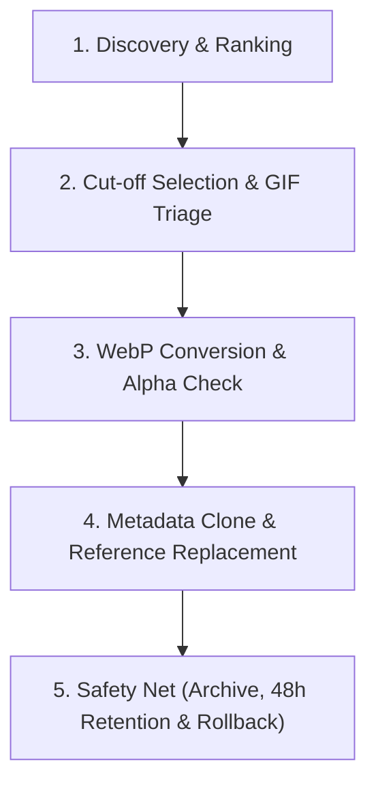

# WP Media Optimization

Skill para modernização e otimização cirúrgica de acervos de mídia legados no WordPress, focada em redução de peso de página, melhoria expressiva de LCP (Largest Contentful Paint) e integridade de dados/SEO.

## Quando utilizar esta Skill

Utilize quando:
- O site WordPress possui um acervo legado pesado em `/wp-content/uploads/` com formatos legados (`.jpg`, `.jpeg`, `.png`, `.bmp`, `.gif`).
- O Largest Contentful Paint (LCP) ou o PageSpeed Insights acusam imagens pesadas não servidas em formatos de última geração.
- Deseja-se aplicar o princípio de Pareto (80/20): otimizar apenas as mídias acima de um ponto de corte de tamanho (ex: > 250 KB ou Top 100 mais pesadas) sem precisar reprocessar cegamente todo o acervo histórico.
- Requer-se garantia absoluta de preservação de transparência alfa (PNGs), integridade de metadados de SEO (Alt Text, Title, Caption, Description) e plano de rollback reversível (ou quarentena de 48h).

---

## 5 Fases do Procedimento



### Fase 1: Discovery & Ranking (Mapeamento do Banco e Filesystem)

1. **Varredura no Banco de Dados (`posts` do tipo `attachment`):**
   - Identificar anexos com `post_mime_type` pertencentes a:
     - `image/jpeg` (`.jpg`, `.jpeg`)
     - `image/png` (`.png`)
     - `image/bmp` (`.bmp`)
     - `image/gif` (`.gif`)
2. **Correlação com Conteúdo Utilizado:**
   - Mapear em quais `posts`, `pages`, CPTs (Custom Post Types) o anexo está inserido no `post_content` (tags ``, atributos `src`, `srcset`) ou como Thumbnail destacado (`_thumbnail_id`).
3. **Cálculo de Pesos e Ordenação Decrescente:**
   - Obter o tamanho em disco do arquivo principal e de seus sub-sizes intermediários (`_wp_attachment_metadata`).
   - Apresentar tabela com:
     - ID do Anexo
     - Nome do arquivo e caminho relativo
     - Tamanho total em disco (Bytes/KB/MB)
     - Formato original
     - Contagem de posts/páginas vinculados

---

### Fase 2: Ponto de Corte & Triagem de GIFs Animados

1. **Definição do Ponto de Corte (Cut-off):**
   - Oferecer ao usuário opções claras:
     - *Por tamanho mínimo:* Ex: Apenas imagens acima de `300 KB`.
     - *Por percentil/volume:* Ex: Top 100 imagens mais pesadas.
     - *Por impacto estimado:* Ex: Reduzir os maiores arquivos que somam os primeiros 500 MB do acervo.
2. **Triagem Especial de GIFs (Animados vs Estáticos):**
   - **GIFs Animados:** Detectar presença de múltiplos frames (assinatura gráfica `\x00\x21\xF9\x04` ou contagem de quadros via GD/Imagick).
   - **Regra de Ouro:** Não converter GIFs animados automaticamente nesta fase para evitar perda de animação ou artefatos indevidos.
   - **Aviso de Conscientização:** Exibir no relatório a lista de GIFs animados encontrados, seus tamanhos, onde estão embutidos e o alerta de impacto no LCP para que o desenvolvedor/gestor providencie a substituição manual (ex: vídeo MP4/WebM ou animação Lottie).
   - **GIFs Estáticos (1 frame):** Podem prosseguir para conversão para WebP normalmente.

---

### Fase 3: Conversão WebP Cirúrgica (Preservando Transparências)

Para cada arquivo qualificado até o ponto de corte:
1. **Verificação de Suporte:** Garantir que o ambiente PHP possui extensão `gd` (com `imagewebp`) ou `imagick` com suporte a WebP.
2. **Preservação de Transparência:**
   - Em arquivos PNG e GIFs de 1 frame com canal alfa, assegurar a retenção de `imagesavealpha($img, true)` e `imagealphablending($img, false)` para GD, prevenindo fundos pretos ou brancos opacos indesejados.
3. **Conversão do Original e Miniaturas Registradas:**
   - Gerar a versão `.webp` no mesmo diretório original (ex: `uploads/2023/05/foto.jpg` -> `uploads/2023/05/foto.webp`).
   - Gerar as versões `.webp` para cada tamanho intermediário listado em `_wp_attachment_metadata` (ex: `foto-300x200.webp`, `foto-1024x768.webp`).
4. **Validação de Tamanho (Regra de Sanidade):**
   - Se por alguma anomalia de compressão o WebP gerado ficar maior que o original, o original é mantido e a conversão desse item é descartada.

---

### Fase 4: Clonagem de Metadados de SEO & Substituição de Referências

1. **Clonagem e Preservação de Metadados de SEO:**
   - O registro do anexo original (`post_type = 'attachment'`) preserva integralmente:
     - `post_title` (Título da Imagem)
     - `post_excerpt` (Legenda / Caption)
     - `post_content` (Descrição)
     - Metadado `_wp_attachment_image_alt` (Texto Alternativo / Alt Text essencial para SEO)
2. **Atualização dos Metadados do Anexo:**
   - Atualizar `_wp_attached_file` para apontar para o novo arquivo `.webp`.
   - Atualizar `post_mime_type` para `image/webp`.
   - Atualizar a matriz `_wp_attachment_metadata` com os novos nomes de arquivos `.webp` para as sub-sizes.
3. **Substituição Cirúrgica no Conteúdo (`post_content`):**
   - Nos posts e páginas mapeados na Fase 1, substituir URLs antigas pelas novas URLs `.webp`.
   - Substituir referências nos atributos `src` e listas `srcset`.
   - Manter as tags de classes nativas do WP (`wp-image-{ID}`) intactas.

---

### Fase 5: Safety Net (Arquivamento, Retenção 48h e Rollback)

1. **Manifesto de Auditoria e Rollback (`rollback.json`):**
   - Registrar para cada imagem alterada:
     - `attachment_id`
     - Caminho original vs novo caminho WebP
     - Mime types
     - Lista de `post_id` alterados no banco
     - Metadados anteriores
2. **Compactação dos Originais:**
   - Empacotar todos os arquivos originais substituídos em um arquivo compactado (ex: `backup-media-legacy-{timestamp}.tar.gz` ou `.zip`).
3. **Opções de Retenção e Descarte:**
   - **Opção A (Download / Exportação para Nuvem):** Fornecer o caminho do arquivo compactado para download imediato ou transferência para bucket/S3.
   - **Opção B (Retenção Programada de 48h - Recomendada):** Manter os originais em quarentena (`/uploads/_legacy_quarantine/`) e agendar via WP-Cron ou crontab do sistema a deleção dos originais após 48 horas de teste em produção.
   - **Opção C (Rollback Imediato):** Caso seja detectado qualquer problema visual ou de compatibilidade, rodar o script com `--action=rollback`, que restaura as referências de banco do `rollback.json` e recoloca os arquivos originais.
   - **Opção D (Deleção Imediata):** Expurgo imediato dos originais se o usuário confirmar que possui backup full externo.

---

## Estrutura de Arquivos da Skill

```text
skills/wp-media-optimization/
├── SKILL.md                          # Este guia mestre
├── scripts/
│   ├── audit_media.php               # Varredura, cálculo de pesos e detecção de GIFs animados
│   ├── convert_and_stage.php         # Conversão em lote, preservação alfa, backup/quarentena e update no DB
│   └── rollback.php                  # Restauração instantânea via rollback.json (quarentena/backup + DB)
└── references/
    ├── webp-best-practices.md        # Parâmetros recomendados de qualidade e compressão
    └── gif-animation-detection.md    # Como identificar múltiplos quadros em arquivos GIF
```
