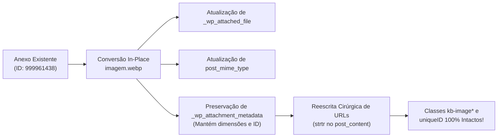

# Compatibilidade Universal com Construtores de Blocos (Block Builders)

## O Problema dos Block Builders Modernos (Kadence, Spectra, Elementor, Gutenberg Core)

Construtores de blocos avançados como **Kadence Blocks**, **Spectra**, **GenerateBlocks** e o próprio **WordPress Core** não tratam imagens apenas como simples tags ``. Eles amarram propriedades visuais críticas aos identificadores de anexo (`attachment_id`):

1. **Atributo `id` no delimitador de bloco:**
   ```html
   <!-- wp:kadence/image {"id":999961438,"sizeSlug":"full","uniqueID":"999958454_4d6e4d-b2"} -->
   ```
2. **Classes CSS dinâmicas baseadas no ID:**
   ```html
   <figure class="wp-block-kadence-image kb-image999958454_4d6e4d-b2 size-full">
   ```
3. **Estilos compilados em runtime/inline:**
   O CSS gerado pelo construtor associa regras de `max-width`, `aspect-ratio`, `object-fit`, bordas e margens especificamente à classe dinâmica e ao `id` do anexo registrado no banco.

---

## A Falha da Re-criação de Anexos (Anti-Pattern)

Muitas ferramentas amadoras de otimização convertem imagens criando um **novo anexo** com um novo ID (ex: subindo `imagem.webp` e recebendo o ID `999962230`) e em seguida substituem o ID ou a URL no post.

### Consequências Desastrosas:
- **Perda de CSS e Estilos de Bloco:** O construtor de blocos não reconhece o novo ID na árvore de dependências CSS compilada.
- **Distorção Visual Extrema:** Imagens de alta resolução (ex: 2560px de largura) perdem o limite de largura do contêiner e explodem visualmente, ocupando 100% da tela ou quebrando o grid de galerias.
- **Ruptura de Lightbox e Atributos de Galeria:** Plugins como Simple Lightbox (`SLB`) ou Kadence Gallery perdem o vínculo com os metadados do anexo.

---

## O Padrão Ouro: Mutação In-Place com Preservação de Identidade

A skill `wp-media-optimization` implementa a técnica de **In-Place Attachment Mutation**:



### Regras Mandatórias de Engenharia:
1. **Preservação Compulsória de IDs:** O ID do anexo no `wp_posts` **nunca deve ser alterado**.
2. **Atualização Atômica de Metadados:**
   - `_wp_attached_file` passa a apontar para o novo arquivo `.webp` no disco.
   - `post_mime_type` é atualizado para `image/webp`.
   - `_wp_attachment_metadata` preserva as dimensões `width` e `height` originais, alterando apenas os nomes dos arquivos das sub-sizes no array `sizes`.
3. **Reescrita Segura de URLs (`strtr`):**
   - Apenas o caminho textual da URL (`.../imagem.jpg` -> `.../imagem.webp`) é substituído no `post_content`.
   - Nenhum atributo JSON interno de bloco (`uniqueID`, `captionStyles`, `kadenceDynamic`) sofre alteração estrutural.
